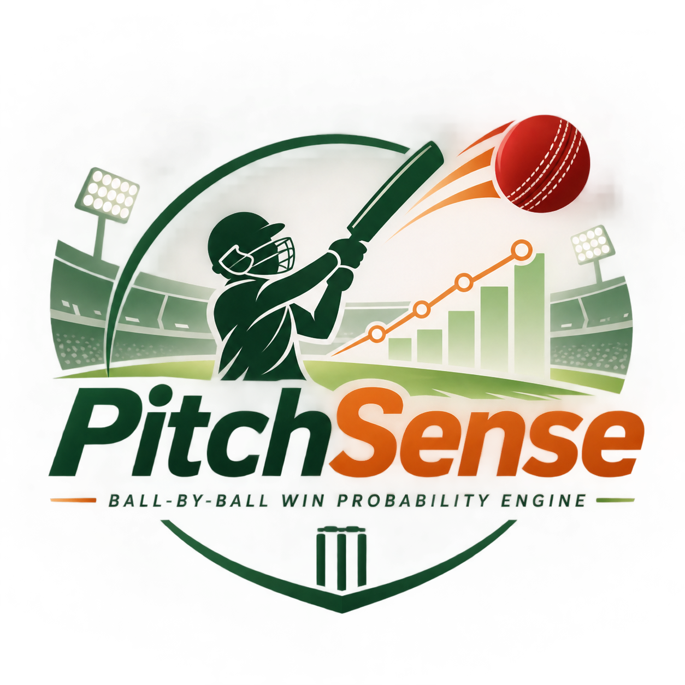
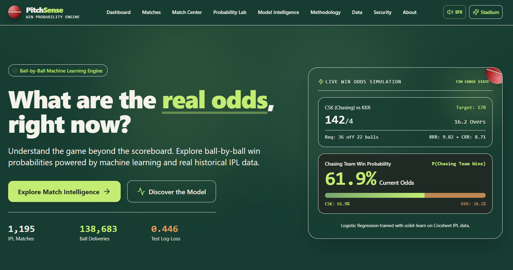
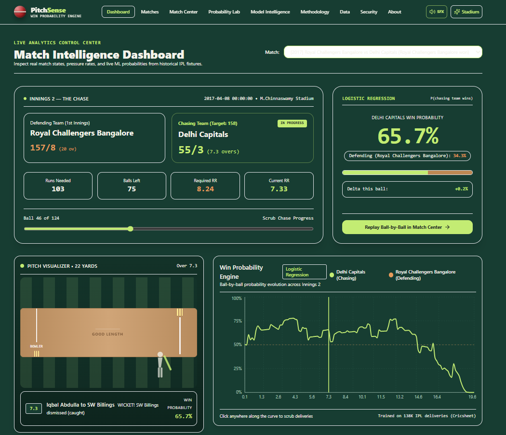
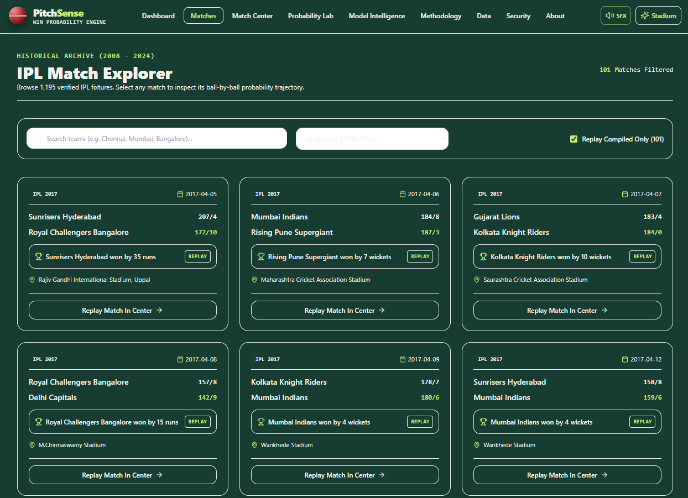
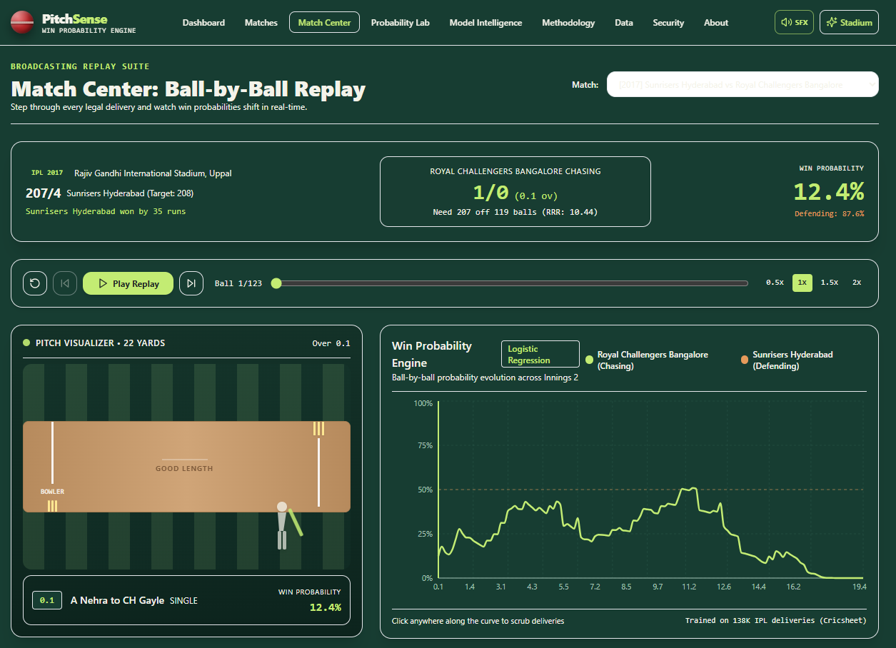
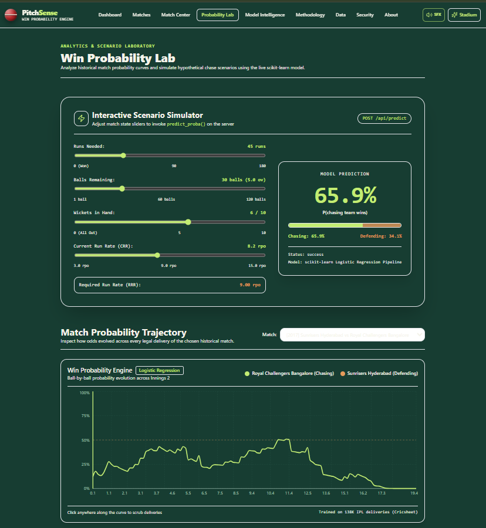
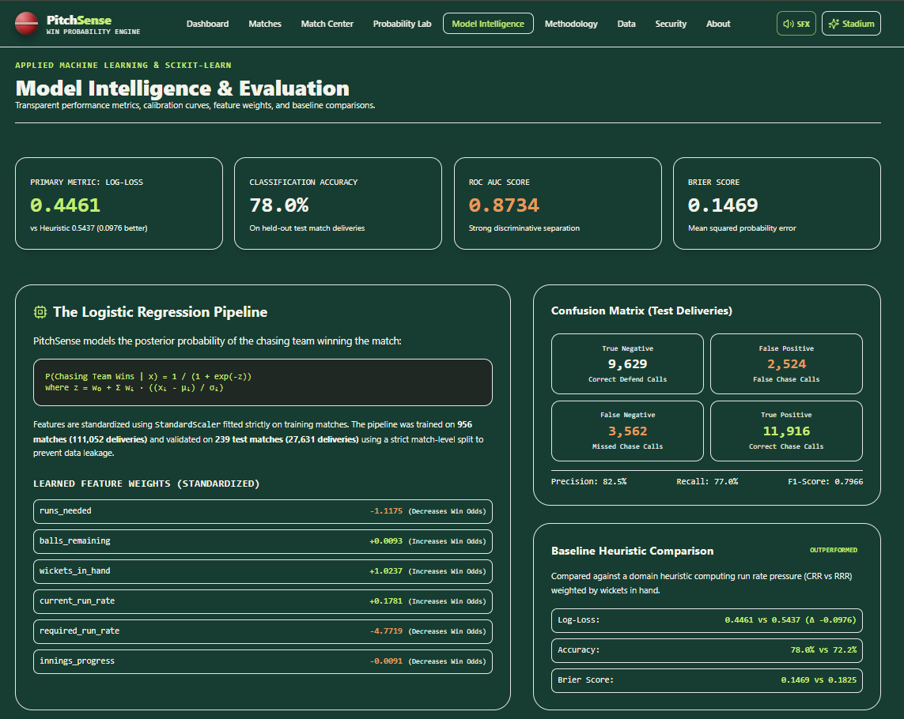

<p align="center">
  
</p>

<h1 align="center">PitchSense 🏏</h1>

<p align="center">
  <strong>"What are the real odds, right now?"</strong>
</p>

<p align="center">
  An ML-powered T20 cricket analytics platform that predicts the chasing team's<br/>
  ball-by-ball win probability using historical IPL data and an explainable Logistic Regression model.
</p>

<p align="center">
  
  
  
  
  
  
  
</p>

<p align="center">
  <a href="https://pitchsense-black.vercel.app/"><strong>Live Demo</strong></a> ·
  <a href="https://github.com/dk-khandelwal06/pitchsense"><strong>GitHub Repository</strong></a> ·
  <a href="https://www.linkedin.com/in/daksh-khandelwal-b02748391/"><strong>Developer LinkedIn</strong></a>
  <a href=""><strong>Demo Video</strong></a>
</p>

---

## Overview

Cricket commentary is full of intuition — "this team is favourite here" — rarely backed by a number. **PitchSense** replaces that intuition with a calculated probability, recomputed after every delivery of a T20 run chase.

It combines a real historical dataset (Cricsheet IPL ball-by-ball data), explicit match-state feature engineering, and an interpretable **scikit-learn Logistic Regression** pipeline to estimate `P(chasing team wins)` at any point in an innings — then wraps that model in an interactive Next.js application for exploring historical matches and simulating hypothetical ones.

---

## Application Preview

<table>
<tr>
<td width="50%">

**01 — Landing Experience**

The PitchSense visual identity and introductory experience.

</td>
<td width="50%">

**02 — Analytics Dashboard**

Match intelligence, match-state metrics, and win probabilities at a glance.

</td>
</tr>
<tr>
<td width="50%">

**03 — IPL Match Explorer**

Historical IPL match discovery and filtering.

</td>
<td width="50%">

**04 — Match Center**

Ball-by-ball replay with cricket pitch visualization and live probability updates.

</td>
</tr>
<tr>
<td width="50%">

**05 — Probability Lab**

Interactive probability simulator and match-trajectory visualization.

</td>
<td width="50%">

**06 — Model Intelligence**

Logistic Regression evaluation: confusion matrix, calibration, and feature weights.

</td>
</tr>
</table>

---

## 🎯 The Problem

A T20 run chase shifts in pressure after almost every delivery. What actually matters is not gut feeling but a handful of measurable quantities:

- **Runs needed** to win
- **Balls remaining** in the innings
- **Wickets in hand**
- **Current run rate** achieved so far
- **Required run rate** to finish the chase

Broadcast graphics rarely quantify how these combine into an actual probability — PitchSense does.

## 💡 The PitchSense Approach

PitchSense turns raw historical deliveries into match-state features, then learns the relationship between those features and the chase outcome.

<p align="center">

```
Cricsheet Data  →  JSON Processing  →  Feature Engineering  →  Logistic Regression  →  Win Probability  →  Interactive Match Replay
```

</p>

---

## ✨ Key Features

- 🏏 Ball-by-ball win probability predictions for the chasing team
- 📚 Historical IPL match explorer across verified fixtures
- ▶️ Interactive historical match replay, delivery by delivery
- 🟢 Cricket pitch visualization of each ball
- 📈 Win-probability trajectory chart across an innings
- 🧪 Interactive **scenario simulator** (hypothetical match states, not live cricket)
- 📊 Model evaluation dashboard — confusion matrix, calibration curve, feature-weight analysis
- ⚖️ Logistic Regression vs. heuristic baseline comparison
- 🎨 Three visual themes — Stadium, Light, and Dark
- 🔊 Procedural Web Audio API sound effects (muted by default)

> **Note:** All predictions — historical replay and the Probability Lab alike — run on past match data or simulated inputs. PitchSense does not connect to a live cricket score feed.

---

## ⚙️ How It Works

```
Cricsheet IPL JSON Data
        │
        ▼
 Data Ingestion & Nested JSON Flattening   (backend/ingestion/)
        │
        ▼
 Feature Engineering                        (runs_needed, balls_remaining,
        │                                    wickets_in_hand, current_run_rate,
        │                                    required_run_rate, innings_progress)
        ▼
 Match-Level Train/Test Split                (prevents cross-match data leakage)
        │
        ▼
 Heuristic Baseline  ──────────────┐
        │                          │
        ▼                          ▼
 Logistic Regression Pipeline   Evaluation & Comparison
 (scikit-learn, ml/train.py)
        │
        ▼
 P(Chasing Team Wins) via predict_proba()
        │
        ▼
 Next.js Web Application — replay, simulation & model-intelligence dashboards
```

The model target is **`P(Chasing Team Wins)`**, produced with scikit-learn's `predict_proba()` rather than a bare class label, because the deliverable is a *probability*, not just a win/loss call.

The **match-level split** (956 train / 239 test matches) is deliberate: splitting by individual delivery would leak information from the same match into both the training and test sets, inflating accuracy artificially.

---

## 📊 Machine Learning & Performance

Trained on **138,683 historical deliveries** from **1,195 verified IPL fixtures**, split at the match level into **956 training matches** (111,052 deliveries) and **239 held-out test matches** (27,631 deliveries).

| Metric | Logistic Regression | Heuristic Baseline |
| :--- | ---: | ---: |
| Log-Loss | **0.4461** | 0.5437 |
| Accuracy | **77.97%** | 72.17% |
| F1-Score | **0.7966** | 0.7236 |
| Brier Score | **0.1469** | 0.1825 |
| ROC AUC | **0.8734** | — |

**Why these metrics:**

- **Log-loss** is the primary metric — it penalizes a confidently wrong probability far more than a merely wrong one, which matters when the deliverable *is* a probability.
- **Accuracy alone is insufficient** — it collapses a 51% vs. a 99% prediction into the same "correct" bucket, hiding how calibrated the model actually is.
- **The match-level split** keeps the test set honest by ensuring no delivery from a test match was ever seen, in any form, during training.
- **Calibration** (see the calibration curve in `artifacts/model/evaluation_metrics.json`) checks whether a predicted 70% actually wins about 70% of the time — the real measure of a trustworthy probability model.

The Logistic Regression pipeline improves on the rule-based heuristic baseline across every metric above, most notably in log-loss and Brier score — i.e., it produces better-calibrated probabilities, not just more correct labels.

---

## 🛠️ Technology Stack

**Frontend**


**Backend & Machine Learning**


**Deployment & Tools**


---

## 🚀 Quick Start / Local Installation

### Prerequisites
- Python 3.10+ (tested with Python 3.13)
- Node.js 18+ (tested with Node 20 / 22)
- npm

### Backend Setup
```bash
pip install -r requirements.txt
python tests/backend/run_tests.py
```

### Frontend Setup
```bash
npm install
npm run dev
```

### Local Website
[http://localhost:3000](http://localhost:3000)

> The Next.js app serves live predictions through its own API routes (`app/api/predict`) using the pre-trained model weights in `lib/model_weights.json`. The standalone FastAPI service (`api/index.py`) is also included and can be run independently with Uvicorn for match discovery, replay, and metrics endpoints.

---

## 📁 Project Structure

```
pitchsense/
├── app/                   # Next.js 15 App Router — pages + native API routes
│   ├── dashboard/         # Analytics dashboard
│   ├── matches/           # IPL match explorer
│   ├── match-center/      # Ball-by-ball replay
│   ├── probability-lab/   # Scenario simulator
│   ├── model-intelligence/# Model evaluation dashboard
│   ├── methodology/ about/ data-sources/ security/
│   └── api/                # predict, matches, model, health routes
├── components/            # Cricket visuals, charts, theme & sound engine
├── api/                   # Standalone FastAPI backend (api/index.py)
├── backend/
│   ├── ingestion/          # Cricsheet download + match processing
│   └── services/           # Match store builder
├── ml/
│   └── train.py             # Model training, baseline, evaluation
├── artifacts/model/        # logistic_regression.joblib + evaluation_metrics.json
├── lib/                    # Typed API client + embedded model weights
├── tests/backend/          # Backend test suite
├── docs/                   # Architecture, methodology, licensing, deployment guides
├── package.json             # Frontend dependencies
├── requirements.txt          # Python ML dependencies
└── vercel.json                # Vercel deployment configuration
```

---

## 📜 Data Source & Licensing

Historical match data is sourced from **[Cricsheet](https://cricsheet.org/)** ([downloads](https://cricsheet.org/downloads/)), released under the **Open Data Commons Attribution License (ODC-By v1.0)** ([license terms](https://cricsheet.org/licensing/)):

> Data courtesy of Cricsheet (https://cricsheet.org), made available under the Open Data Commons Attribution License.

23 DLS-affected matches and 25 tied/no-result matches were excluded during data preparation to keep win/loss labels clean — see `docs/data-license.md` for the full exclusion notes.

This application's source code does not currently include a LICENSE file in the repository.

---

## 🔭 Limitations & Future Development

PitchSense v1 is intentionally scoped to **historical IPL T20 data and match-state-only features**. Planned directions include:

- Player-quality features (recent batter strike rate, bowler economy)
- Random Forest / Gradient Boosting models
- Extension to ODI and Test match formats
- Genuine live cricket score integration

These are future possibilities — not currently implemented.

---

## 👤 Developer

<p align="center">
  <strong>Daksh Khandelwal</strong><br/>
  Applied AI & Data Science Undergraduate | IIT Jodhpur
</p>

<p align="center">
  <a href="https://www.linkedin.com/in/daksh-khandelwal-b02748391/">LinkedIn</a> ·
  <a href="https://github.com/dk-khandelwal06/pitchsense">GitHub Repository</a> ·
  <a href="https://pitchsense-black.vercel.app/">Live Project</a>
</p>
