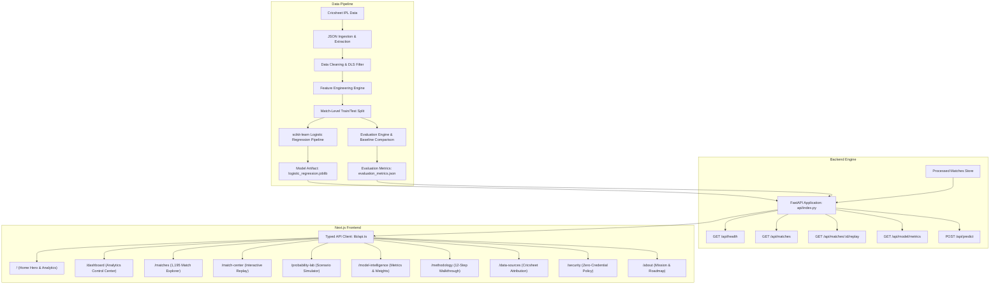

# PitchSense Architecture Overview

## 1. System Vision
PitchSense is a sports analytics and applied machine learning platform engineered to answer the central question of modern T20 cricket: **"What are the real odds, right now?"**

The platform calculates calibrated ball-by-ball win probabilities for the chasing team across Indian Premier League matches using an explainable scikit-learn Logistic Regression pipeline.

## 2. Directory Layout
- `app/`: Next.js 15 App Router pages and native API route handlers.
- `components/`: UI components, cricket pitch visualizer, animated ball, sound synthesizer.
- `api/`: FastAPI backend implementation (`api/index.py`).
- `ml/`: Model training (`ml/train.py`), evaluation scripts, feature calculations.
- `backend/`: Data ingestion, processing, and match store builders.
- `data/processed/`: Structured match metadata and precompiled ball-by-ball replays.
- `artifacts/model/`: Serialized scikit-learn pipeline and evaluation metrics.
- `tests/backend/`: Integration and unit tests for API endpoints and model validation.
- `docs/`: Comprehensive technical and deployment documentation.

